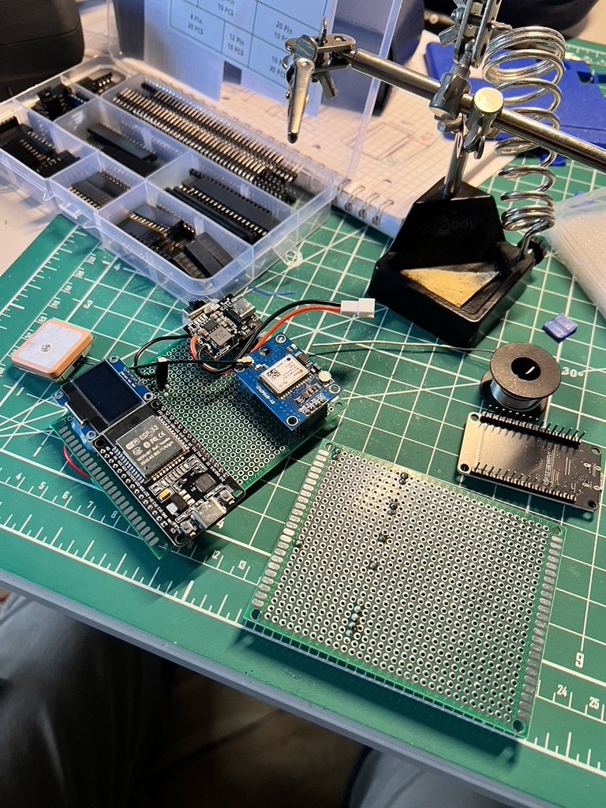

<p align="center">
  
</p>

# End-to-end GPS tracker with live position streaming

Live GPS tracker for event shuttles. A Raspberry Pi with a GPS module (or an ESP32) sends its coordinates to a FastAPI server, which displays them
on a Leaflet map (standalone or embedded, localized in Italian and English) including POIs (points of interest). An admin panel (behind authentication)
sets the hours during which the position is exposed on the maps, as well as the POIs. Outside the configured hours, the `/coordinates` endpoint returns
`off_service`, so the device can stay on without publicly exposing its position.

Italian version: [README_IT.md](README_IT.md)

## Stack
Raspberry Pi (Zero 2 W) + gpsd, Python 3.9, FastAPI, Pydantic v2, Jinja2, Leaflet 1.9.
Deployed on Railway. The ESP32 version is identical on the server side.
HTTP Basic auth for the admin, bearer token for the device.

## Layout
```
RPiGPS/      # device-side: gpsd reader + HTTP poster
Server/      # FastAPI app, JSON persistence, admin templates + JS
branding/    # logos
```

## Setup and installation

Server, locally:

```bash
python -m venv .venv && source .venv/bin/activate
pip install -r requirements.txt
cp Server/.env.example Server/.env   # fill in values
cd Server && uvicorn api:app --reload
```

Fill in: `ADMIN_USERNAME`, `ADMIN_PASSWORD`, `DEVICE_TOKEN`, and `ENV` (`development` exposes `/docs`).
The admin panel is at the `/admin` endpoint, the public map at `/embed`.

Device:

```bash
cd RPiGPS
cp .env.example .env   # set URL_SITO_GPS + DEVICE_TOKEN
python networking.py
```

macOS has no `gpsd`: with `ENV=development` the code reads `mock_gps_coordinates.txt` for debugging purposes.


## Project status
Work in progress. Since it had to be deployed during an event held in Turin at the end of October 2026, I deliberately chose to keep some technical debt in exchange for a faster, and hopefully already working, implementation. The `/embed` endpoint, despite its name, is a full landing page with hardcoded tags, information and styles. It's not an elegant solution for a large-scale application: this is exactly the technical debt mentioned above.

Coming next:
  - Proper multi-line support. Currently, running more than one line requires two services running in parallel, and therefore two different links (this is also why the landing page mentions a second line that isn't shown at that link).
  - ESP32 firmware review: to meet the deadlines and have a user-friendly device ready for deployment a few weeks before the event, Claude Code was used generatively only with respect to the `/esp32_test` folder.
  - KiCad schematic of the PCB. The prototype currently runs on a perfboard, with tin soldering and solid-core wires. To keep the current to the GPS module steady a capacitor of about 220 µF was added between GND and Vin, acting as a low-pass filter.
  - Files for the case of the whole prototypes, designed in Autodesk Fusion and 3D printed (FDM).

## Photos



## License

MIT.

Made by [andrepadawan](https://github.com/andrepadawan), a bachelor's Computer Engineering student at Politecnico di Torino.
